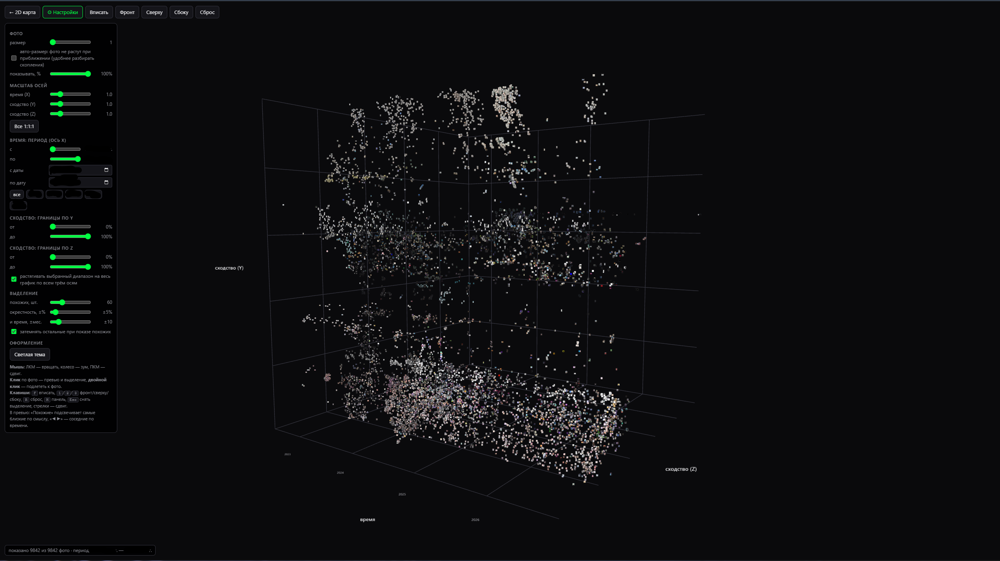

# Semamap

Карта вашей фотоколлекции: фото раскладываются по смыслу, похожие лежат рядом. Всё работает локально, фото никуда не отправляются.

*English: Semamap builds a zoomable semantic map (CLIP embeddings + UMAP) of a local photo collection, with text search, similar-photo lookup and a 3D view (X = time, Y/Z = similarity). Everything runs on your machine.*

<!-- Когда сделаете скриншоты (на демо-коллекции, не на личных фото), положите их в docs/ и раскомментируйте:

## Скриншоты



-->

## Возможности

- **Карта по смыслу.** Для каждого фото считается эмбеддинг (CLIP через `open_clip`, по умолчанию `ViT-L-14`), затем UMAP раскладывает их на плоскости. Карта нарезается на тайлы и листается как обычная карта (OpenSeadragon).
- **Поиск по смыслу.** Запрос можно писать по-русски или по-английски (русский переводится моделью `Helsinki-NLP/opus-mt-ru-en`).
- **Похожие фото, теги и «зоны».** Подписи районов карты и теги берутся из словаря (`core/config.py`, свой словарь задаётся через `--vocab`).
- **3D-вид** (`/3d`). По оси X время, по Y и Z сходство. Вместо точек миниатюры фото. Есть масштаб и границы по каждой оси, выбор периода по датам и годам, подсветка похожих, «окрестность» выбранного фото, виды «фронт/сверху/сбоку», тёмная и светлая тема.
- **Карты за период.** Можно собрать отдельную карту за диапазон дат.
- **Инкрементальная индексация.** Повторный запуск `index` обрабатывает только новые и изменённые файлы.
- Форматы: JPEG, PNG, WebP, BMP, GIF, TIFF, HEIC/HEIF.

> В словаре тегов есть блок «18+»: он нужен, чтобы находить и отличать откровенный контент в личном архиве. Список можно заменить своим файлом через `--vocab`.

## Требования

- Python 3.10+ (или Docker).
- Видеокарта NVIDIA для индексации желательна: на процессоре будет в разы медленнее. Для карт RTX 50-й серии нужна сборка PyTorch с CUDA 12.8 или новее.
- Место на диске: база с эмбеддингами, миниатюрами и тайлами заметно больше самих списков путей, закладывайте до нескольких гигабайт на десятки тысяч фото.

## Быстрый старт (без Docker)

```bash
git clone <адрес репозитория> semamap && cd semamap
python -m venv .venv && source .venv/bin/activate      # Windows: .venv\Scripts\activate
pip install -r requirements.txt

python main.py index /путь/к/фото       # считает эмбеддинги (долго, можно прервать и продолжить)
python main.py build                    # строит карту, тайлы и 3D
python main.py serve                    # откроется http://127.0.0.1:8765
```

3D-вид открывается по адресу `http://127.0.0.1:8765/3d` или кнопкой «3D» на карте.

Если памяти мало, уменьшите нагрузку: `index --workers 2 --batch 32` и `build --workers 4`.

## Docker

```bash
cp .env.example .env          # впишите PHOTOS_DIR и, при необходимости, логин/пароль
docker compose build
docker compose run --rm semamap sh -c "python main.py index /photos && python main.py build"
docker compose up -d
```

Образ собирается один раз, модель кэшируется в `hf_cache/`, данные лежат в `data/`. Контейнер перезапускается сам (`restart: unless-stopped`). По умолчанию порт открыт только на этом компьютере (`SEMAMAP_BIND=127.0.0.1`).

Индексацию в контейнере на видеокарте нужно отдельно настраивать (NVIDIA Container Toolkit). Проще проиндексировать на хосте, а карту собрать и показать в контейнере. Тогда в базе будут пути хоста, поэтому задайте `SEMAMAP_PATH_MAP=путь_на_хосте=/photos`, иначе «Открыть полностью» покажет только превью.

## Команды

| Команда | Что делает |
| --- | --- |
| `index <папки...>` | эмбеддинги и миниатюры. Флаги: `--model`, `--pretrained`, `--cell`, `--batch`, `--workers`, `--force` |
| `build` | UMAP, тайлы и 3D-атлас. Флаги: `--date-from`, `--date-to`, `--name`, `--neighbors`, `--min-dist`, `--reproject`, `--no-3d`, `--workers` |
| `serve` | веб-сервер. Флаги: `--host`, `--port`, `--map`, `--vocab`, `--no-search`, `--no-translate`, `--path-map`, `--auth-user`, `--auth-pass` |

Общий флаг `--data` задаёт папку с данными (по умолчанию `data`). Карта за период: `python main.py build --date-from 2023-01-01 --date-to 2023-12-31`, затем `python main.py serve --map 2023-01-01_2023-12-31`.

Полная переиндексация: удалите содержимое `data/` и запустите `index` и `build` заново. Смена модели или `--cell` требует `index --force`.

## Безопасность и приватность

- **Папка `data/` содержит миниатюры и пути ваших личных фото.** Она в `.gitignore`, не добавляйте её в репозиторий. Перед `git push` проверьте `git status`.
- По умолчанию сервер слушает только `127.0.0.1`. Если открываете его в сети, обязательно задайте `--auth-user` и `--auth-pass` (или `SEMAMAP_USER` и `SEMAMAP_PASS`) и не публикуйте порт в интернет без HTTPS.
- Фото открываются сервером по идентификатору из базы, а папка с фото в Docker монтируется только для чтения.
- Скрипты на странице подгружают OpenSeadragon и three.js с CDN (jsDelivr), поэтому браузеру нужен интернет.

## Проверки (CI)

При каждом коммите GitHub Actions проверяет синтаксис Python и JavaScript, что CLI запускается, и что в репозиторий не попали данные (`data/`, `*.sqlite`, `.env`). Конфиг: `.github/workflows/ci.yml`.

## Структура

```
main.py            точка входа (index / build / serve)
core/              индексатор, UMAP и тайлы, теги, перевод, база
web/server.py      HTTP-сервер и API
web/static/        интерфейс: index.html + app.js (карта), 3d.html (3D)
data/              данные (в git не попадают)
docs/              скриншоты для README
.github/workflows/ проверки CI
```

## Лицензия

MIT, см. [LICENSE](LICENSE). Перед публикацией впишите своё имя в файл `LICENSE`.
